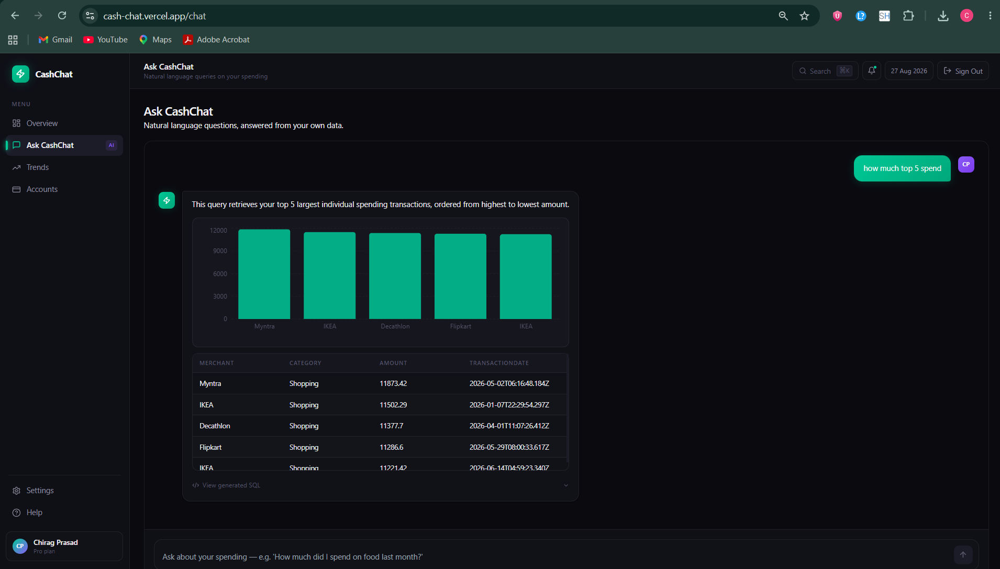
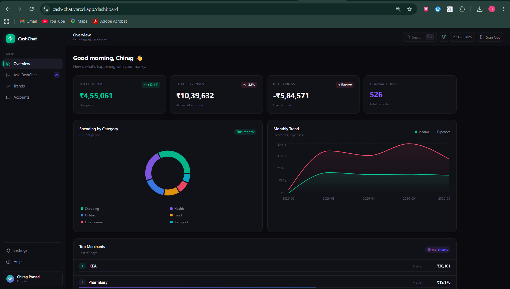
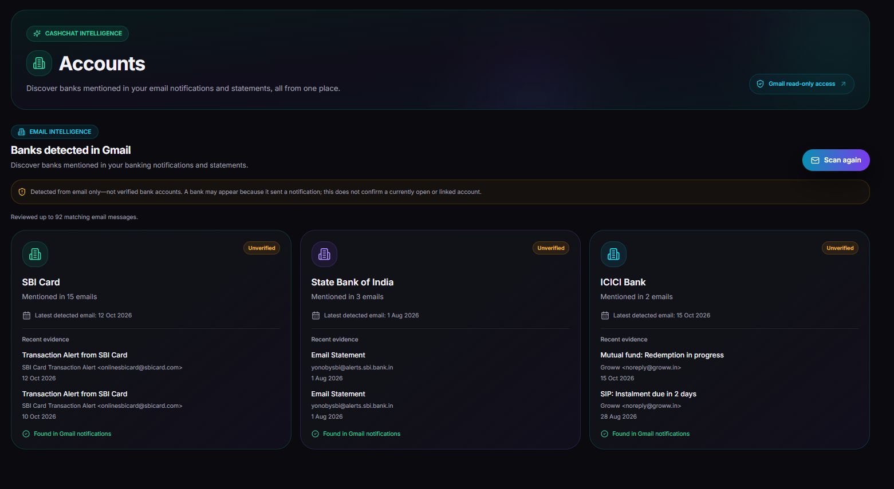
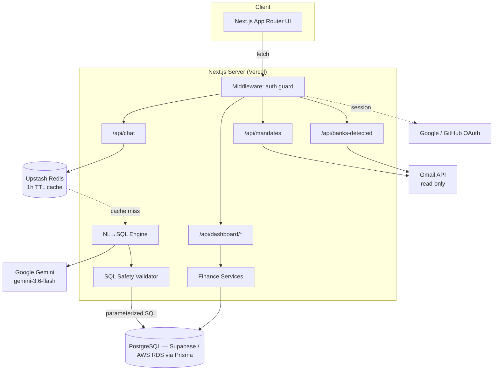

# CashChat

AI-powered personal finance dashboard with natural-language analytics. Ask
questions like *"How much did I spend on food in May?"* and get back a real
answer computed from your own transaction data — not a hallucinated guess.
It can also scan your Gmail (read-only) to surface **UPI mandates** and the
**banks** that email you, all in one place.

**Live demo:** https://cash-chat.vercel.app

```
"How much did I spend on food in May?"
        │
        ▼
  Gemini (gemini-3.6-flash) → { sql, explanation, chartType }
        │
        ▼
  SQL Safety Layer (validateSql) ── rejects anything that isn't a single,
        │                           tenant-scoped SELECT/WITH
        ▼
  Postgres (parameterized execution, userId bound — never concatenated)
        │
        ▼
  Chart-data shaping → Redis cache (1h TTL) → JSON response → Chat UI
```

## Features

- **Ask CashChat** — natural-language questions answered with a chart, a
  table, and a "View generated SQL" panel so every number is auditable.
- **Overview dashboard** — income / expenses / net savings / transaction
  cards, spending-by-category donut, monthly income-vs-expense trend, top
  merchants, and recent transactions.
- **UPI Mandates** — scans Gmail for mandate registration, pre-debit, and
  AutoPay notifications and extracts the sender, date, amount, and frequency.
- **Accounts** — detects which banks (SBI, HDFC, ICICI, Axis, Kotak and
  ~20 more) appear in your email notifications and statements.
- **Instant demo data** — every new user is seeded with two accounts and
  500+ realistic transactions on first sign-in, so the dashboard and chat
  work right away.
- **Landing page, light / dark / system themes**, and a Settings and Help
  page.
- **Trends & forecasting** — placeholder page; in development.

## Screenshots

### Dashboard



### AI Chat



### UPI Mandates

<!-- TODO: add a screenshot of the /mandates page and save it as src/screenshots/mandates.png -->


### Accounts

<!-- TODO: add a screenshot of the /accounts page and save it as src/screenshots/accounts.png -->


## Architecture



## Tech stack

Next.js 14 (App Router) · TypeScript · Tailwind CSS · Recharts · TanStack
Query · Zustand · NextAuth.js (Google + GitHub, JWT sessions) · Prisma ORM ·
PostgreSQL (Supabase or AWS RDS) · Google Gemini (`@google/genai`,
`gemini-3.6-flash`) · Gmail API (read-only) · Upstash Redis · Docker ·
GitHub Actions.

## Security model — read this before deploying

The chat assistant lets an LLM generate SQL that runs against a real
database. That's the riskiest part of this app, so it's defended in layers:

1. **Schema-aware, security-ruled prompt** (`src/lib/openai/prompt.ts`,
   `schemaContext.ts`) — the model is only told about `accounts` and
   `transactions`, and is instructed to always scope queries to the current
   user via a `:currentUserId` placeholder, never to write DML/DDL, and to
   treat the user's question as untrusted input (prompt-injection guard).
2. **`validateSql()`** (`src/lib/validators/sql.ts`) — every generated query
   is parsed and rejected unless it: is a single statement; has no
   comments; starts with `SELECT`/`WITH`; contains no DML/DDL/admin
   keywords; only references whitelisted tables/columns; and includes the
   tenant-scoping placeholder exactly once. See
   `src/lib/validators/__tests__/sql.test.ts` for the adversarial cases this
   is tested against (stacked statements, comment-smuggled DROPs, etc.).
3. **Parameter binding, not string concatenation** — the placeholder is
   swapped for Postgres's `$1` and the *actual* userId is passed as a bound
   parameter to `prisma.$queryRawUnsafe`. The model never sees or controls
   the real user id.
4. **Defense in depth (recommended for production)**: point `DATABASE_URL`
   at a Postgres role that only has `GRANT SELECT` on `accounts` and
   `transactions` — so even a theoretical bypass of layers 1–3 can't write
   or read other tables. This repo doesn't provision that role for you (it
   depends on your hosting setup); see the migration / deployment notes below.

No layer here is sufficient alone — they're intentionally redundant.

### Gmail access

The **Mandates** and **Accounts** pages use Google's
`gmail.readonly` scope, requested at Google sign-in.

- **Read-only** — CashChat cannot send, modify, or delete email.
- **Metadata only for bank detection** — `/api/banks-detected` reads just the
  `From`, `Subject`, and `Date` headers.
- **Mandates read message bodies** — `/api/mandates` fetches matching
  messages in full, only to extract an amount and frequency. Nothing from
  your mailbox is written to the database.
- **Tokens live in the signed JWT session cookie**, not in the database. The
  access token is refreshed server-side with the refresh token when it
  expires.
- **Results are hints, not bank confirmations.** An email can't prove a
  mandate is still active, cancelled, or due. Verify in your UPI app or bank.
  Scan results are cached per user in `sessionStorage` for the browser
  session only.
- **Google OAuth consent screen** — `gmail.readonly` is a restricted scope.
  While your OAuth app is in "Testing" mode, only the test users you add in
  the Google Cloud console can connect Gmail. Public use requires Google's
  verification.

## What's fully implemented vs. what's a starting point

**Fully implemented and tested:** Prisma schema + seed script, the SQL
safety validator (with a passing test suite), the NL→SQL prompt and
pipeline, all dashboard/chat API routes, the dashboard and chat UI, Redis
caching, NextAuth wiring, Gmail-based Mandates and Accounts pages,
auto-seeded demo data for new users, the landing page and theming,
Docker/Compose, and the GitHub Actions CI pipeline.

**Worth strengthening before a real launch:**
- *Streaming*: the chat UI shows staged loading states (thinking →
  querying) rather than token-level streaming, because there's nothing
  meaningful to stream until SQL has been generated *and* executed. True
  token streaming of the `explanation` field is a small follow-up (switch
  to `generateContentStream`, forward deltas over SSE).
- *Rate limiting* on `/api/chat` (e.g. Upstash's `@upstash/ratelimit`) isn't
  wired in yet — worth adding before exposing this publicly, since each
  uncached question costs a Gemini call.
- *Mandate detection is heuristic*: it's keyword and regex matching over a
  Gmail search (up to 30 messages), not a bank-verified mandate list.
- *Trends & forecasting* page is a placeholder.
- *Migration history*: `prisma/schema.prisma` is final, but no
  `prisma/migrations/` folder is checked in yet — run
  `npx prisma migrate dev --name init` once against a real database and
  commit the result (CI currently uses `prisma db push` for simplicity).
- *Read-only DB role* described above isn't provisioned by this repo.
- *Demo data only*: transactions are generated sample data; there is no
  bank-account syncing.

## Project structure

```
src/
  app/                 # Next.js App Router pages + API routes
    page.tsx           # Landing page (signed-in users redirect to /dashboard)
    login/             # /login
    dashboard/         # /dashboard (summary cards, charts, tables)
    chat/              # /chat (NL chat assistant)
    accounts/          # /accounts (banks detected from Gmail)
    mandates/          # /mandates (UPI mandates detected from Gmail)
    trends/            # /trends (coming soon)
    settings/          # /settings (theme, account)
    help/              # /help (example questions, FAQ)
    api/
      auth/[...nextauth]/
      chat/            # POST /api/chat
      dashboard/       # GET summary | categories | trends | merchants | transactions
      mandates/        # GET /api/mandates (Gmail scan)
      banks-detected/  # GET /api/banks-detected (Gmail scan)
  components/
    dashboard/         # Greeting, SummaryCards, RecentTransactionsTable
    charts/            # CategoryPieChart, MonthlyTrendChart, TopMerchantsTable
    chat/              # ChatWindow, ChatMessage, ChatInput, ResultRenderer
    accounts/          # BanksDetectedFromGmail
    layout/            # AppShell, Sidebar, Navbar
    brand/, theme/     # Logo, ThemeProvider, ThemeToggle
    ui/                # shadcn-style primitives (button, card, table)
  lib/
    prisma.ts          # Prisma singleton
    redis.ts           # Upstash cache helpers
    auth.ts            # NextAuth config (Google w/ Gmail scope, GitHub)
    session.ts         # requireUserId() for route handlers
    demoData.ts        # Seeds demo accounts + transactions for new users
    openai/            # Gemini client, schema context, prompt, NL->SQL orchestration
                       # (folder name is historical — it now calls Gemini)
    validators/        # zod schemas + the SQL safety validator (+ tests)
  services/
    finance/           # summary, categories, trends, merchants, transactions
    chat/              # chatService: cache -> NL->SQL -> execute -> shape
  hooks/, store/, types/, screenshots/
prisma/
  schema.prisma
  seed.ts
.github/workflows/
  ci.yml                      # type-check, lint, test, build
  keep-supabase-active.yml    # daily ping so a free Supabase DB isn't paused
Dockerfile, docker-compose.yml
```

## Getting started

```bash
npm install
cp .env.example .env   # fill in real values (see below)

# local Postgres + Redis via Docker
docker compose up -d db redis

npx prisma migrate dev --name init   # creates migration history + applies schema
npm run db:seed                       # optional: seeds a demo user + 500+ transactions

npm run dev
```

Visit `http://localhost:3000`, sign in with Google or GitHub, and you'll
land on `/dashboard`. On your first sign-in CashChat automatically creates
two sample accounts and 500+ sample transactions for you (`createDemoData`),
so no seeding is needed to try it. `npm run db:seed` is still available if
you want a separate demo user, viewable via Prisma Studio:
`npm run prisma:studio`.

To try **Mandates** and **Accounts**, sign in with Google and approve the
Gmail read-only permission. Both pages also let you reconnect from within
the page if access is missing or has expired.

### Required environment variables

See `.env.example` for the full list and where to obtain each value:
`DATABASE_URL`, `DIRECT_URL`, `NEXTAUTH_SECRET`, `NEXTAUTH_URL`,
`GOOGLE_CLIENT_ID/SECRET`, `GITHUB_CLIENT_ID/SECRET`, `GEMINI_API_KEY`,
`UPSTASH_REDIS_REST_URL/TOKEN`.

- `DIRECT_URL` is required by the Prisma schema. Use a direct (non-pooled)
  Postgres connection for migrations; `DATABASE_URL` can be a pooled
  connection. For local Docker, set both to the same value.
- For Gmail features, enable the **Gmail API** in your Google Cloud project
  and add `http://localhost:3000/api/auth/callback/google` (and your
  production equivalent) as an authorized redirect URI.

### Tests

```bash
npm run test         # vitest — currently covers the SQL safety validator
npm run type-check
npm run lint
```

## Deployment

**App (Vercel):**
1. Push this repo to GitHub.
2. Import it in Vercel, set the environment variables from `.env.example`.
3. Vercel runs `npm run build` (which runs `prisma generate` via
   `postinstall`) automatically on every push to `main`.

**Database (Supabase or AWS RDS PostgreSQL):**

*Supabase (used for the live demo):*
1. Create a Supabase project and copy its Postgres connection strings.
2. Set `DATABASE_URL` to the pooled connection string and `DIRECT_URL` to the
   direct connection string, then run `npx prisma migrate deploy` (or
   `prisma db push`) once.
3. On the free tier, projects pause after inactivity. The
   `keep-supabase-active.yml` workflow runs a daily `SELECT 1`; add the
   connection string as a `SUPABASE_DB_URL` GitHub Actions secret.

*AWS RDS:*
1. Create a PostgreSQL 16 RDS instance (private subnet + security group
   allowing inbound 5432 from Vercel's IPs or via a connection pooler like
   RDS Proxy / PgBouncer — Vercel functions are short-lived, so connection
   pooling matters at scale).
2. Set `DATABASE_URL` and `DIRECT_URL` to the RDS endpoint, then run
   `npx prisma migrate deploy` from CI/CD (the GitHub Actions workflow in
   this repo runs `prisma db push` for PR validation against an ephemeral
   CI Postgres; wire a separate deploy step to run `migrate deploy` against
   RDS on merge to `main`).
3. Optionally provision a read-only `app_readonly` role and have the
   app connect with it, per the Security Model section above.

**Gemini:** create an API key at https://aistudio.google.com/apikey and set
`GEMINI_API_KEY`.

**Cache (Upstash Redis):** create a free-tier Redis database at
console.upstash.com, copy the REST URL + token into `.env`.

**Docker (self-hosting / local parity with prod):**
```bash
docker compose up --build
```
This builds the multi-stage `Dockerfile` (Next.js standalone output) and
runs it alongside local Postgres + Redis containers. In production, swap
the `app` service's `DATABASE_URL` to your hosted database and drop the
local `db`/`redis` services entirely (Upstash is HTTP-based and needs no
container).

## CI

`.github/workflows/ci.yml` runs on every push/PR to `main`: install →
`prisma generate` → type-check → lint → unit tests → schema sync against an
ephemeral Postgres service container → production build.

`.github/workflows/keep-supabase-active.yml` runs daily (and on demand) to
keep a free-tier Supabase database from being paused.
